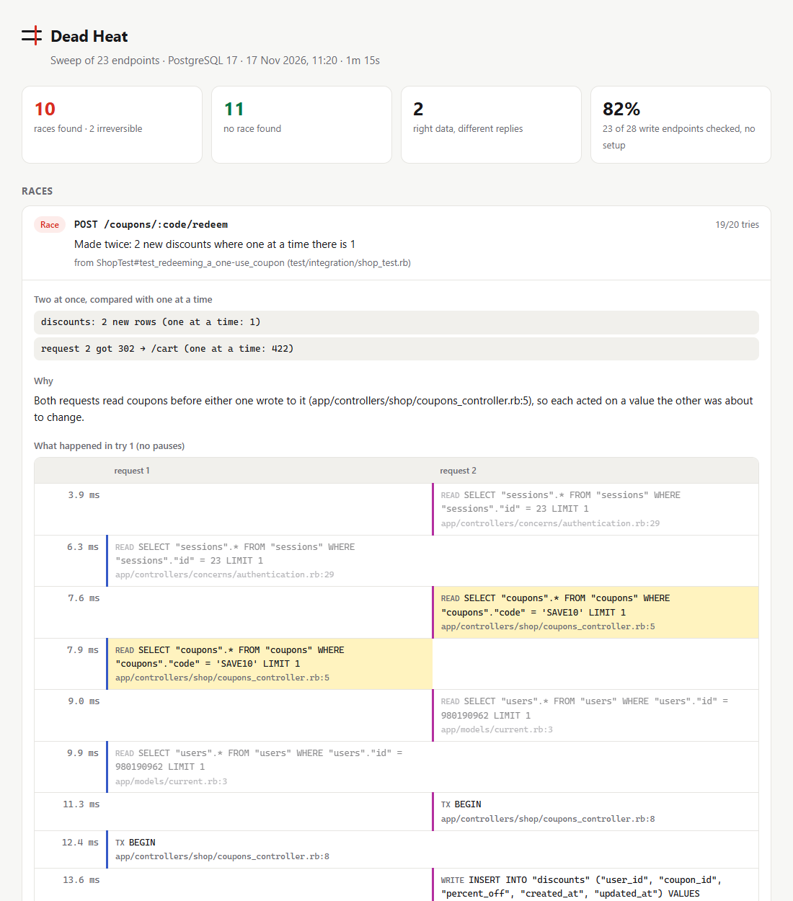

# Dead Heat

**Finds the bugs in a Rails app that only happen when two requests arrive at once.**

A store has one shirt left. Two people press Buy at the same moment:

```
Alice's request: "how many shirts?" → 1     ✓ enough
Bob's request:   "how many shirts?" → 1     ✓ enough
Alice's request: create order, set stock to 0
Bob's request:   create order, set stock to 0
Result: 2 orders for 1 shirt.
```

Every normal test passes, because tests send one request at a time. Dead Heat sends them together.
It takes the requests your tests already make, sends each one **twice at the same moment**, and checks
whether the result could ever happen **one after the other**. When it couldn't, it tells you what broke,
shows both requests' database queries side by side, points at the line of code, suggests the fix, and
writes a test so the bug can't come back.

*In racing, a dead heat is when two runners cross the line at exactly the same moment.*

## What it finds

| | Example | One at a time | Two at once |
| --- | --- | --- | --- |
| Made twice | Double-click "Place order" | 1 order, then "already placed" | 2 orders, card charged twice |
| Used twice | One-use coupon | 1 discount, then "already used" | 2 discounts |
| Below zero | Gift card, wallet, stock | stops at 0 | goes below 0 |
| Lost update | Two people like a post | likes = 2 | likes = 1 |
| Duplicate despite a rule | `validates :email, uniqueness: true` | 1 account, then "taken" | 2 accounts |
| Crash | A unique index the code doesn't handle | second request handled | second request gets a 500 |
| Sent twice | Confirmation email, shipping job, payment call | sent once | sent twice (marked *irreversible*) |

## Results

**Against the tools Rails developers already use.** Corner Store (in [`demo/`](demo)) is a small Rails 8
store with ten realistic races planted in it, a fixed twin for each, and an ordinary passing test for
every feature. Each tool ran on the same code ([`bench/tools_bench.rb`](bench/tools_bench.rb)):

| Tool | Planted races caught | False alarms on the fixed twins |
| --- | --- | --- |
| The app's own tests | 0 of 10 | 0 of 10 |
| [database_consistency](https://github.com/djezzzl/database_consistency) | 1 of 10 | 0 of 10 |
| [active_record_doctor](https://github.com/gregnavis/active_record_doctor) | 1 of 10 | 0 of 10 |
| Dead Heat scan (reads the code) | 10 of 10 | 0 of 10 |
| **Dead Heat sweep** (runs it, no setup) | **10 of 10** | **0 of 10** |

The same on PostgreSQL and MySQL. On SQLite the sweep finds 9: Rails 8 runs SQLite writes with
`BEGIN IMMEDIATE`, which really does stop the tenth (a uniqueness validation) from racing there. Two of
the races sent something that can't be taken back: a second confirmation email and a second shipping job.
The two existing tools only look for a uniqueness validation without a unique index, so they catch that
one kind; every other race lives in controller code they don't read.

**On a real app.** [Lobsters](https://github.com/lobsters/lobsters), the link aggregator, fixed a race in
December 2024: two stories from the same new site at once could crash on a unique index. Dead Heat, with a
ten-line race test ([`bench/historical/lobsters`](bench/historical/lobsters)):

| Lobsters code | Dead Heat |
| --- | --- |
| Before the fix (`7cc3c14ed`) | broke in **20 of 20** tries |
| The December 2024 fix (`8d601f12d`) | still broke in **4–5 of 20**: the model's uniqueness validation raises `RecordInvalid`, which `find_or_create_by!` doesn't catch |
| The fix that followed a production exception in April 2025 (`b664dccb`) | no race in **100** tries |

So it would have caught the gap in the first fix four months before it reached production.

**Another real one.** [Spree](https://github.com/spree/spree) fixed a "gift card overspend race condition
vulnerability" in March 2026. Two orders using one gift card at once could each take its whole balance.

| Spree code | Dead Heat |
| --- | --- |
| Before the fix (`397173a1`) | broke in **40 of 40** tries (160 spent from a 100 card) |
| The fix (`1ce4d240`) | no race in **40** tries |

Dead Heat's scan points at the cause in the code before the fix: `gift_card.lock!` called outside a
transaction, which releases the lock right away.

**All together:** 3 of 3 real, fixed race bugs reproduced before their fixes, no race found after the
fixes that worked, and the one fix that didn't work was caught. A zero-setup sweep of today's Lobsters
(its 171 request specs pass), and the Spree race test, also turned up races that are still in their
code. Details of unfixed races aren't published here. All of this is in [`bench/results.md`](bench/results.md), with the
commands to rerun it.

## Quick start

```bash
bundle add deadheat --group "development, test"
bin/rails generate deadheat:install
bin/deadheat sweep
```

```
Dead Heat sweep (Minitest)
Recording the requests your tests make…
Found 23 write requests in 31 tests. Checking 23 endpoints, 20 tries each…

  ✗ POST /products/:product_id/buy     Made twice: 2 new orders where one at a time there is 1  18/20 tries  [irreversible]
  ✗ POST /coupons/:code/redeem         Made twice: 2 new discounts where one at a time there is 1  19/20 tries
  ✗ POST /wallet/withdraw              Went below zero: wallets #3 balance_cents ended at -3000  18/20 tries
  ✗ POST /reviews/:id/helpful          Lost update: reviews #3 helpful_count went 0 → 1, one at a time 0 → 2  17/20 tries
  …
  ✓ 11 endpoints with no race found
Checked 23 of the app's 28 write endpoints (82%) using its existing tests, with no setup.
10 races found (2 with side effects that can't be undone) in 1m 15s.
Regression tests written: test/races/sweep/post_products_product_id_buy_race_test.rb, …
```

Then `bin/deadheat report --open` for the details, or `/deadheat` while your app runs in development:



## The four commands

| Command | Takes | What it does |
| --- | --- | --- |
| `bin/deadheat sweep` | minutes | Sends each write request your request/integration tests make twice at once. One test per endpoint (`--all` for every request). Writes a regression test for each race. |
| `bin/deadheat scan` | seconds | Reads the code (no database) and lists places that look racy: check-then-act without a lock, arithmetic done in Ruby, look-then-create, uniqueness without an index. Suspects, not findings. |
| `bin/rails test test/races` | seconds | Your race tests, including the ones the sweep wrote. They fail while the race is there. |
| `bin/deadheat report` | instant | The latest results as one HTML page. |

## Race tests

For races between two *different* people (two buyers, one shirt), or code that isn't a request (jobs,
service objects), write a race test. It's a normal test file:

```ruby
class CheckoutRaceTest < Deadheat::RaceTest
  race "two buyers, one shirt" do |r|
    r.setup { @shirt = Product.create!(name: "Shirt", stock: 1) }
    r.as(users(:alice)) { post checkout_path, params: { product_id: @shirt.id } }
    r.as(users(:bob))   { post checkout_path, params: { product_id: @shirt.id } }
    r.check("never sell more than we have") { Order.where(product_id: @shirt.id).count <= 1 }  # optional
  end

  race "the payment webhook arrives twice" do |r|
    r.setup { @order = orders(:unpaid) }
    r.twice { post webhooks_order_paid_path, params: { order_id: @order.id } }
  end

  race "two jobs charge the same order" do |r|
    2.times { r.run { ChargeOrderJob.perform_now(orders(:unpaid).id) } }
  end
end
```

RSpec works the same way with `RSpec.describe "Checkout", type: :race do … end`. `r.as(user)` signs the
user in for that request's own session: Devise and Rails 8's `sign_in_as` work as they are; anything
else is one line in `race_helper.rb`. The `check` is optional: without it, Dead Heat already compares
the data, the replies, the emails and the jobs with every one-at-a-time order.

When a race test fails, the message tells the whole story:

```
Race: “two buyers, one shirt” broke in 18 of 20 tries (seed 4821, PostgreSQL 17)

  ✗ Made twice: 2 new orders where one at a time there is 1 (18 tries)
      orders: 2 new rows (one at a time: 1)
      bob got 302 → /orders/:new (one at a time: 422)

    Why: Both requests read products before either one wrote to it
         (app/controllers/checkouts_controller.rb:12), so each acted on a value the other was about to change.

    What happened in try 3 (every request waits after its 1st read of products until all have made it):
        1.2 ms  alice │ SELECT "products".* FROM "products" WHERE "products"."id" = 1   app/controllers/checkouts_controller.rb:12
        1.4 ms  bob   │ SELECT "products".* FROM "products" WHERE "products"."id" = 1   app/controllers/checkouts_controller.rb:12
        3.9 ms  alice │ INSERT INTO "orders" …                                         app/controllers/checkouts_controller.rb:14
        4.6 ms  bob   │ INSERT INTO "orders" …                                         app/controllers/checkouts_controller.rb:14
        …

    Fix:
      • Lock the row while deciding: wrap the read-check-write in `record.with_lock { … }` …
      • Or let the database check and change in one statement: `Model.where(id: id).where("stock >= ?", n).update_all(…) == 1` …

  Reproduce: DEADHEAT_SEED=4821 bin/rails test test/races/checkout_race_test.rb:2
```

## How it works

Nothing here touches database internals. It's ordinary Ruby and Rails:

1. **Racing for real.** Each request runs in its own thread with its own database connection, and they
   start together from a starting line. Ruby lets threads run while one waits on the database, so the
   queries really overlap.
2. **Small, targeted pauses.** Two requests started together still usually finish one after the other:
   each takes only milliseconds. So Dead Heat first watches a one-at-a-time run and finds each read that
   is followed by a write to the same table, like "read the stock, then save the stock". In each try it
   widens that gap a different way:
   - every request waits after that read until the others have made it too
   - whichever request reads first waits a moment
   - one request starts a little later, as the second click of a double click does
   - small random pauses

   The pauses come from a seed, so a failing try can be replayed.
3. **Comparing with one at a time.** From the same starting data it runs the requests one after
   another in every order, then together. If the together result matches none of the one-at-a-time
   results (rows, replies, errors, emails sent, jobs queued, outside HTTP calls through WebMock), it's
   a race. You don't have to say what "correct" means. New ids, timestamps and random tokens are
   ignored: anything that differs between two identical one-at-a-time runs is noise, not a race.
4. **Exactly the same data every try.** After setup it saves a snapshot, and before each try it puts
   back only the tables that were written. When it's done, every table is exactly as it was.
5. **The sweep** records which requests your tests make and which of them write, then reruns one test
   per endpoint. When that test reaches the request, Dead Heat copies its session (cookies, signed-in
   user), sends the request twice at once, compares, and stops the test.

Dead Heat never says "safe". It says "no race found in 20 tries", because a timing bug can't be proven
absent.

## Safety

It writes to and restores tables, so it refuses to run unless all of these are true:

- Rails is in the test environment
- the database name contains "test"
- Rails' own record in the database says "test"

It also refuses setups that would make its results wrong, and says what to change:

- a connection pool smaller than the number of racing requests + 1
- code reloading turned on
- `allow_concurrency` off
- the test still inside an open transaction

If you use DatabaseCleaner, it steps aside for race tests and the tests the sweep chooses. The `/deadheat`
dashboard is for development and answers only requests from your own computer. Dead Heat doesn't send
anything anywhere.

## Limits

- **Request and integration tests only:** controller tests and browser (system) tests aren't swept.
- **Some reachable endpoints:** the sweep reaches only the endpoints your tests call, and the coverage line says how many that is.
- **Threads, not processes:** races between separate processes (several Puma workers sharing an in-memory cache) aren't modeled.
- **SQLite:** supported. Remember that Rails 8 serializes SQLite writes, so fewer races are possible there, and Dead Heat reports what really happens.
- **Some findings need a person to judge.** Dead Heat shows exactly what differed. A "different result" can be on purpose: an app that de-duplicates log entries writes fewer of them when two requests arrive together.

## Requirements

- Ruby 3.2 or newer (tested on 3.4 and 4.0)
- Rails 7.1 to 8.1
- PostgreSQL, MySQL, MariaDB or SQLite
- Minitest or RSpec

## Developing Dead Heat

Everything runs in Docker, so it works the same on Windows, macOS and Linux:

```bash
docker compose run --rm dev bundle install
docker compose run --rm dev bundle exec rake test             # SQLite, PostgreSQL and MySQL
docker compose run --rm dev bundle exec rake test:sweep       # sweep Corner Store end to end
docker compose run --rm -e DB=postgres dev ruby bench/tools_bench.rb
```

`BUNDLE_GEMFILE=gemfiles/rails_7_1.gemfile` (or 7_2, 8_0, 8_1) runs the tests against another Rails, and
`docker compose --profile ruby4 run --rm dev4 …` against Ruby 4.

Where the ideas come from:
- *Feral Concurrency Control* (Bailis et al., SIGMOD 2015) showed that most Rails apps check invariants in
  code rather than in the database.
- *ACIDRain* (Warszawski and Bailis, SIGMOD 2017) found these bugs in real e-commerce apps.
- Randomized scheduling (Burckhardt et al., ASPLOS 2010) showed that a few well-placed delays find most
  ordering bugs.
